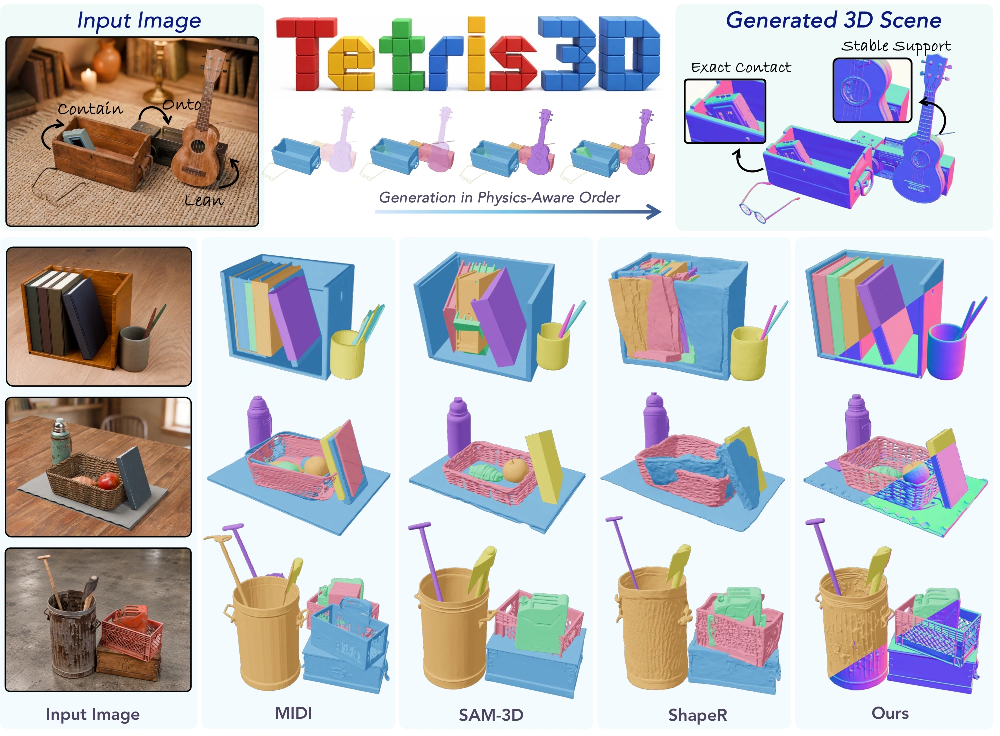

<h1 align="center">Tetris3D: 3D Scene Generation with<br>Objects That Fit Together</h1>

<p align="center">
  <a href="https://kjae0.github.io/">Jaeyeong&nbsp;Kim</a> ·
  <a href="https://jinhyukj.github.io/">Jinhyuk&nbsp;Jang</a> ·
  <a href="https://icetea-cv.github.io/">Jongmin&nbsp;Lee</a> ·
  <a href="https://cvlab-kaist.github.io/Tetris3D/#overview">Kyehong&nbsp;Park</a> ·
  <a href="https://cvlab.kaist.ac.kr/members">Seungryong&nbsp;Kim</a><sup>†</sup>
</p>

<p align="center">KAIST&nbsp;AI<br><sub>† Corresponding author</sub></p>

<h3 align="center">arXiv 2026</h3>

<p align="center">
  <a href="https://cvlab-kaist.github.io/Tetris3D/"></a>
  <a href="https://cvlab-kaist.github.io/Tetris3D/assets/paper/tetris3d-paper.pdf?v=d69c4cedb978"></a>
  <a href="https://arxiv.org/abs/2610.10539"></a>
</p>

> **TL;DR** &nbsp; *From one image to a 3D scene whose objects fit together.*

<p align="center">
  <a href="assets/readme/demo-the-end.pdf"></a>
</p>

<p align="center">
  <a href="#overview">Overview</a> · <a href="#todo">TODO</a> · <a href="#news">News</a> · <a href="#getting-started">Setup</a> · <a href="#inference">Inference</a> · <a href="#training">Training</a> · <a href="#citation">Citation</a>
</p>

<a id="overview"></a>

## ✨ Overview

**[Tetris3D](https://arxiv.org/abs/2610.10539)** reconstructs a complete 3D scene from a single image by generating objects in physical dependency order. Each object uses its neighbors' geometry and physical relationships as context, so its shape and pose account for the scene around it—even where contact and occlusion hide parts of the object.

- **Objects that fit:** model interactions such as support, containment, and leaning during generation.
- **Complete, separate meshes:** recover individual objects together with their placement in a shared scene.

<a id="todo"></a>

## 📌 TODO

- [x] Release the paper and project page.
- [ ] Release inference code and a runnable single-image example.
- [ ] Release training and evaluation code with configurations.
- [ ] Release the ComOb dataset and data preparation tools.
- [ ] Release ComOb dataset construction code.
- [ ] Release pretrained model checkpoints.

Pretrained checkpoints are not currently distributed. Release updates will be announced here.

<a id="news"></a>

## 📰 News

- **2026-10** — The [project page](https://cvlab-kaist.github.io/Tetris3D/) and examples are available.
- **2026-10-07** — Our [arXiv preprint](https://arxiv.org/abs/2610.10539) is available.

<a id="getting-started"></a>

## 🚀 Getting started

> **Release status:** This repository currently provides the paper, demos, and documentation. Implementation and pretrained checkpoints are not yet available here.

```bash
git clone https://github.com/cvlab-kaist/Tetris3D.git
cd Tetris3D
```

To explore the results now, open the [3D scene viewer](https://cvlab-kaist.github.io/Tetris3D/#demos) or the [qualitative comparisons](https://cvlab-kaist.github.io/Tetris3D/#toys4k).

## Inference

🚧 To be updated

## Training

🚧 To be updated

## Citation

If you find Tetris3D useful in your research, please cite:

```bibtex
@misc{kim2026tetris3d,
  title         = {Tetris3D: 3D Scene Generation with Objects That Fit Together},
  author        = {Kim, Jaeyeong and Jang, Jinhyuk and Lee, Jongmin and Park, Kyehong and Kim, Seungryong},
  year          = {2026},
  eprint        = {2610.10539},
  archivePrefix = {arXiv},
  primaryClass  = {cs.CV},
  url           = {https://arxiv.org/abs/2610.10539}
}
```
